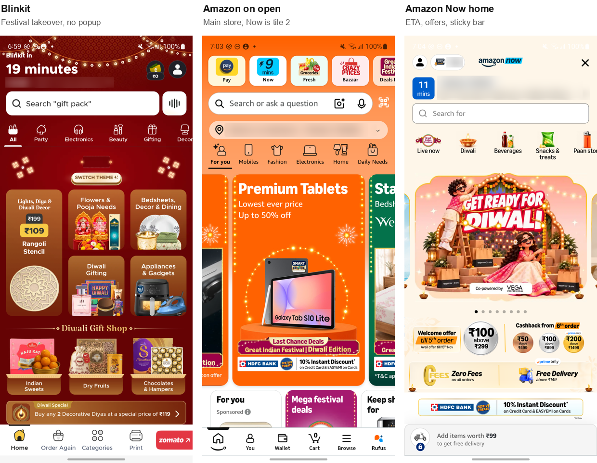
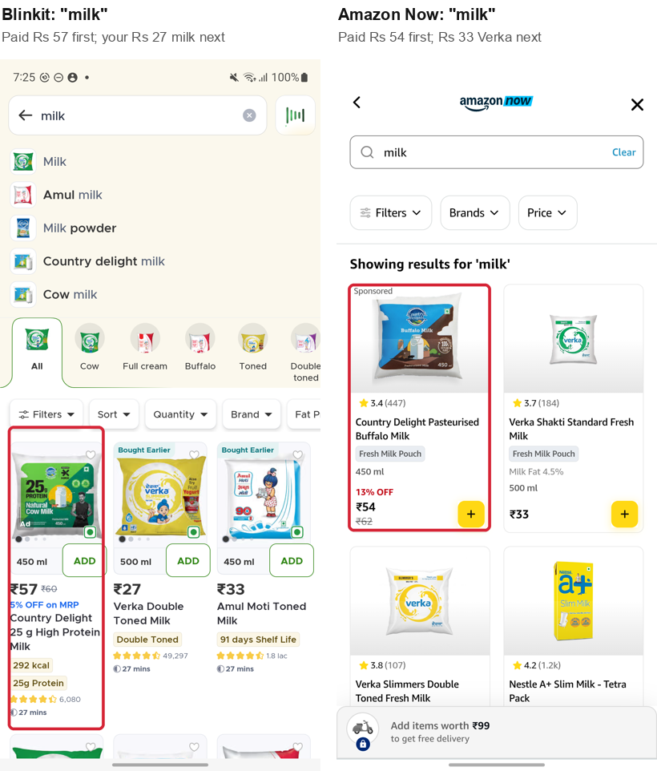
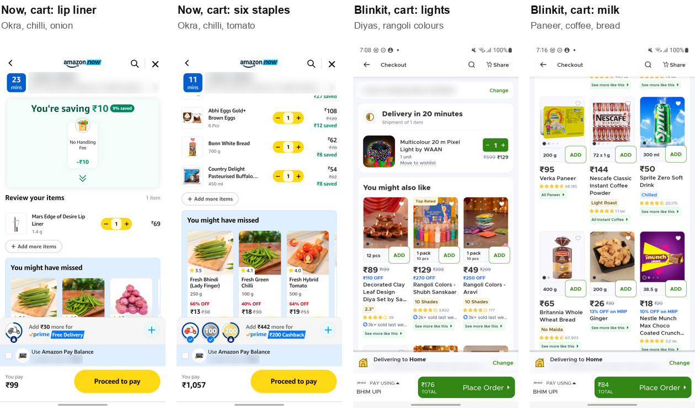

# Blinkit vs Amazon Now: a hands-on teardown

I compared India's two quick-commerce apps the way a shopper actually uses them: same phone, same account, same address, same evening (Diwali week, 4 Nov 2026). I ran 6 shopping scenarios in each app, captured **260+ screens**, and logged every price, fee, ad and recommendation. No order was placed.



## Key findings

1. **Item prices were the same. Fees were not.** Across 11 products found in both apps, prices matched or were within Rs 3 to 21. On a Rs 17 item, Blinkit added **Rs 67 in fees** (delivery, handling, small-cart). Amazon Now charged Rs 30 and waived handling.
2. **Blinkit sells the occasion. Amazon Now sells the deal.** Blinkit opens straight into a festival and gifting home, with groceries about 4 scrolls down. Amazon opens on its main store with a sale popup, and Now is one tap away behind another popup about cashback and zero fees.
3. **Blinkit's search understood intent better.** For "cold and cough" it offered filter chips, a "Feeling under the weather?" collection and mixed remedies. For "type c fast charger" it showed wattage filters. Amazon Now's results were narrower and led with discounts.
4. **Amazon Now showed more ads at the top.** For a birthday search, 3 of the first 4 picks were Sponsored. For cold and cough it was 4 of the first 12, with the same product at rank 1 and rank 3.
5. **Quick delivery didn't cost more per item.** Amazon's normal store listed the same products at the same price or higher, delivered 1 to 12 days later. The cost of speed sits in small-basket fees, not in item prices.



## Scenarios

| # | Shopper goal | What I compared |
|---|---|---|
| 1 | Just browsing | What the home screen pushes, taps to checkout, final bill |
| 2 | Exact item ("amul taaza milk 500ml") | Query handling, typo correction, rank-1 result |
| 3 | A need ("cold and cough") | Filters, collections, share of sponsored results |
| 4 | Weekly top-up (6 staples) | Basket total, fees, cashback, ETA |
| 5 | An occasion (birthday) | Suggestions, sponsored picks, stock-outs |
| 6 | Non-grocery ("type c fast charger") | Spec filters vs discount tags; Amazon main store too |

The full write-up with every table is in **[findings.md](findings.md)**.



## What's in this repo

| Path | What it is |
|---|---|
| [findings.md](findings.md) | Full findings, with a screenshot id for every claim |
| [teardown_data.xlsx](teardown_data.xlsx) | All the data in one workbook |
| `data/*.csv` | Checkout bills, search results, home-screen modules, recommendations, price checks, action log |
| `tool/qc_audit.py` | Python driver that controls the phone over ADB, captures each screen and its UI tree, and refuses any tap on pay, order, login or address buttons |
| `tool/test_qc_audit.py` | Offline tests for that safety guard |
| `analysis/` | Scripts that crunch the CSVs and build the figures, blurring personal details |

## How it was done

- **Device:** Samsung Galaxy S20 FE (Android 13), Blinkit 18.41.0, Amazon 32.19.0.300, driven over ADB from a laptop.
- **Method:** each scenario ran in both apps, alternating which went first. For every screen I saved a screenshot and the UI tree, so ads, prices and ranks are read from the app itself, not estimated.
- **Safety:** the driver's tap guard blocks payment, order, login, consent and address controls. Every run stops at the first screen that asks to pay.

```bash
python3 -m venv .venv && .venv/bin/pip install -r requirements.txt
.venv/bin/python tool/test_qc_audit.py   # offline tests, no phone needed
```

## Limits

One account, one address, one evening, during a festival week, so results reflect this account's history and that moment. For adds I tapped the first result, which leans toward sponsored items, so the baskets are not like-for-like. Raw screenshots are not published because they show personal details.

---
By [Saksham Rathi](https://saksham-rathi.vercel.app). Feedback is welcome in Issues.
